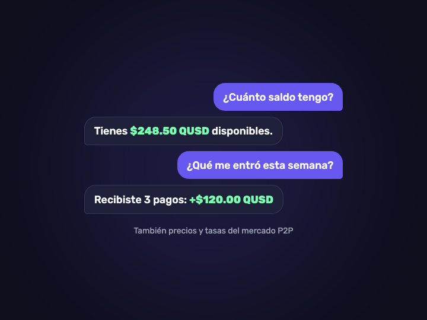
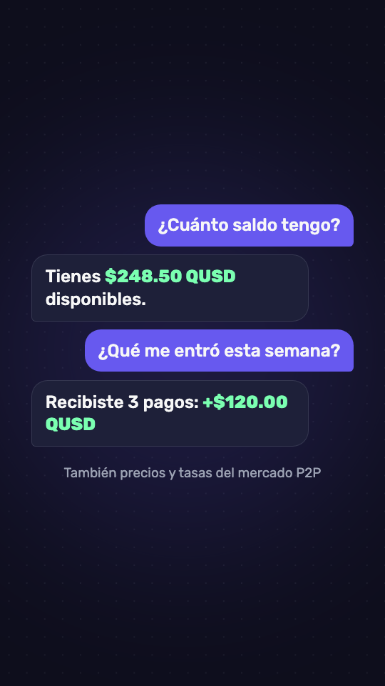
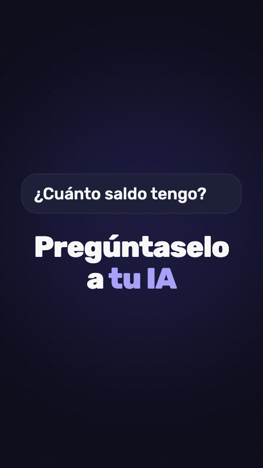
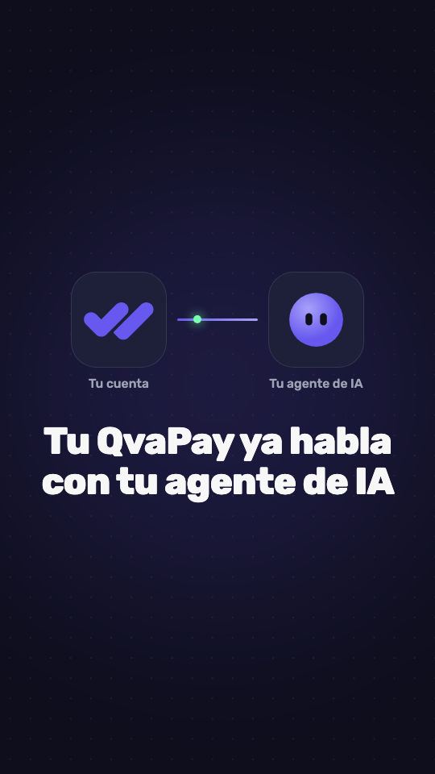
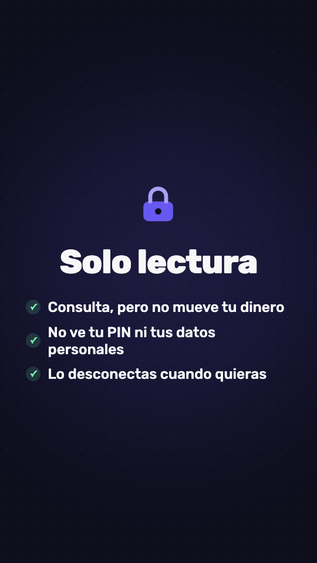
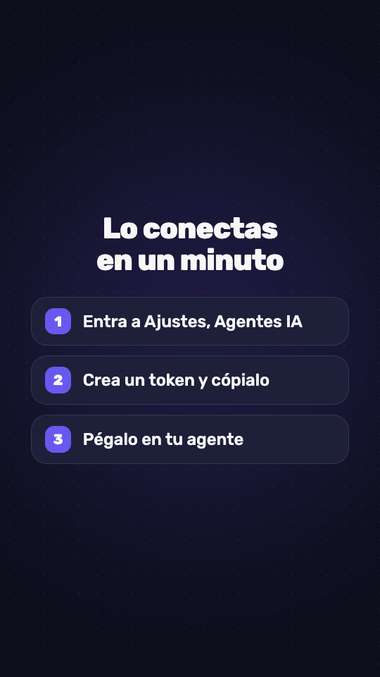
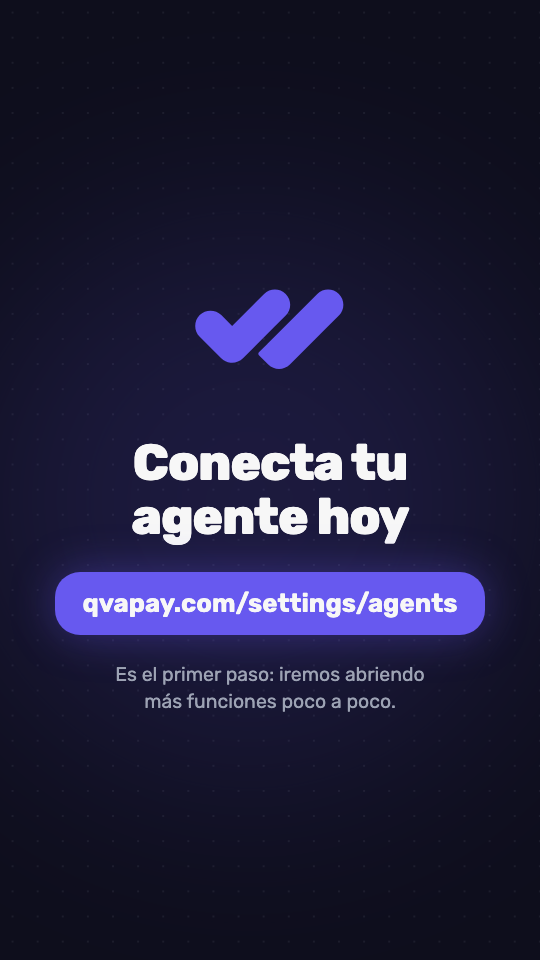
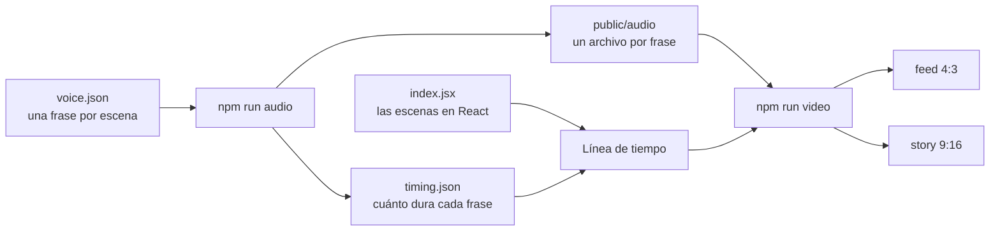

<div align="center">


# Fábrica de videos de QvaPay

**Videos de producto escritos en React. Un guion, un comando, todos los formatos.**

Cada novedad de QvaPay sale de aquí convertida en un video corto para redes:
con su locución, su música y la marca en su sitio, sin abrir un editor de video.


<br />


<sub>El primer video de la fábrica: Agentes IA. Lo que ves sale de <a href="src/videos/mcp/index.jsx"><code>src/videos/mcp</code></a>, tal cual.</sub>

</div>

<br />

## Qué es

Un video aquí no se edita: **se programa**. Cada escena es un componente de React, la locución
es un archivo de texto y el montaje lo calcula el proyecto. Cambiar una frase, un color o el
orden de las escenas es cambiar una línea y volver a renderizar.

- **Un diseño, todos los formatos.** Todo se mide en unidades relativas al lienzo, así que la
  misma escena sale en 4:3 para el feed y en 9:16 para stories sin rehacer nada.
- **La voz manda en el tiempo.** Cada escena dura lo que pide su animación o lo que tarda su
  locución, lo que sea mayor. La voz nunca se corta.
- **Borrador gratis, voz final de pago.** Se monta y se ajusta con la voz del sistema; la voz
  natural se genera al final, y solo para las frases que cambiaron.
- **Marca blindada.** Colores, tipografía y logo viven en un solo archivo. Ningún video los
  redefine.
- **Música que se aparta.** La pista de fondo entra y sale con fundido y baja sola mientras
  alguien habla.

## Un diseño, dos formatos

<table>
<tr>
<td align="center" width="62%"><br /><sub><b>feed</b> · 4:3 · 1440 × 1080</sub></td>
<td align="center" width="38%"><br /><sub><b>story</b> · 9:16 · 1080 × 1920</sub></td>
</tr>
</table>

La misma escena, el mismo código. Lo que cambia entre formatos se decide con `portrait`.

<table>
<tr>
<td align="center"><br /><sub>Gancho</sub></td>
<td align="center"><br /><sub>Conexión</sub></td>
<td align="center"><br /><sub>Demostración</sub></td>
<td align="center"><br /><sub>Seguridad</sub></td>
<td align="center"><br /><sub>Pasos</sub></td>
<td align="center"><br /><sub>Cierre</sub></td>
</tr>
</table>

<sub>Las cifras que aparecen en pantalla son de ejemplo.</sub>

## Empezar

Necesitas:

- **Node.js 20.12 o posterior.**
- **ffmpeg y ffprobe** en el `PATH`, para medir y convertir el audio.
- **macOS** para la voz de borrador, que usa la voz del sistema (`say`). En otros sistemas el
  video se renderiza igual; el audio hay que traerlo de la voz natural o de un locutor.

```bash
git clone https://github.com/qvapay/qvapay-video-factory.git
cd qvapay-video-factory
npm install

npm run studio        # editor en el navegador, con vista previa en vivo
npm run video mcp     # renderiza el video de ejemplo en los dos formatos
```

Los MP4 quedan en `out/`:

```
out/mcp-feed-4x3.mp4
out/mcp-story-9x16.mp4
```

## Cómo funciona



1. Escribes las escenas en React y la locución en un JSON, una frase por escena.
2. `npm run audio` convierte cada frase en un archivo de audio y anota su duración.
3. La línea de tiempo le da a cada escena el tiempo que necesita y coloca la voz y la música.
4. `npm run video` renderiza todos los formatos.

## Hacer un video nuevo

**1. Las escenas.** Crea `src/videos/<nombre>/index.jsx` y exporta `scenes`. Las piezas salen
del kit; tú solo las colocas y dices en qué fotograma entra cada una.

```jsx
import React from 'react'
import { Accent, Check, Headline, Logo, Rise, Sub, UrlPill, useUnits } from '../../kit'

const Intro = () => {
	const { u, portrait } = useUnits()
	return (
		<div style={{ display: 'flex', flexDirection: 'column', alignItems: 'center', gap: 4 * u }}>
			<Headline at={0} size={portrait ? 9 : 7.6}>La novedad, en <Accent>una frase</Accent></Headline>
			<Check at={18}>Primera ventaja</Check>
			<Check at={30}>Segunda ventaja</Check>
		</div>
	)
}

const Cierre = () => {
	const { u } = useUnits()
	return (
		<div style={{ display: 'flex', flexDirection: 'column', alignItems: 'center', gap: 4.4 * u }}>
			<Rise at={2}><Logo size={26} /></Rise>
			<Headline at={12}>Pruébalo hoy</Headline>
			<UrlPill at={24}>qvapay.com</UrlPill>
		</div>
	)
}

// `min`: lo que dura la escena sin voz, en fotogramas a 30 fps
export const scenes = [
	{ id: 'intro', min: 100, component: Intro },
	{ id: 'cierre', min: 120, component: Cierre },
]
```

**2. La locución.** `src/videos/<nombre>/voice.json`, con los mismos `id` de las escenas:

```json
{
	"intro": "Aquí va la frase que acompaña a la primera escena.",
	"cierre": "Y aquí, la del cierre."
}
```

**3. El audio.** Genera la voz de borrador y el `timing.json`:

```bash
npm run audio <nombre>
```

**4. El registro.** Añade el video en [`src/index.jsx`](src/index.jsx):

```jsx
import { scenes as novedadScenes } from './videos/novedad'
import novedadTiming from './videos/novedad/timing.json'

const VIDEOS = {
	mcp: buildTimeline(mcpScenes, mcpTiming),
	novedad: buildTimeline(novedadScenes, novedadTiming),
}
```

Con eso ya existen `novedad-feed` y `novedad-story`. Míralos en `npm run studio` y sácalos con
`npm run video novedad`.

## El kit

Todo lo que comparten los videos está en [`src/kit.jsx`](src/kit.jsx). Una pieza que vaya a
servir en más de un video se escribe ahí.

| Pieza | Para qué |
| --- | --- |
| `useUnits()` | Devuelve `u` (la unidad relativa al lienzo) y `portrait`. Nada se mide en píxeles fijos. |
| `Rise` | Entrada con muelle desde abajo. `at` es el fotograma de la escena en que aparece. |
| `Headline`, `Sub` | Titular y texto de apoyo, centrados y con las líneas equilibradas. |
| `Accent`, `Figure` | Resaltan una palabra en morado claro o una cifra en verde. |
| `Card` | Superficie con borde, la base de casi todos los bloques. |
| `Bubble` | Burbuja de chat. Con `mine`, la escribe la persona. |
| `Step` | Paso numerado. |
| `Check` | Línea con visto bueno. |
| `UrlPill` | Botón de cierre con la dirección. |
| `Logo` | El símbolo de QvaPay en vector, en sus tres variantes. |
| `buildTimeline`, `Video` | La línea de tiempo y el video completo: fondo, escenas, voz y música. |

## Voz

| Comando | Qué hace | Costo |
| --- | --- | --- |
| `npm run audio <video>` | Voz de borrador con la voz del sistema, y `timing.json` | Gratis |
| `npm run audio <video> -- --voice Mónica` | Otra voz del sistema | Gratis |
| `npm run audio <video> -- --keep` | No genera nada: mide los audios que ya estén | Gratis |
| `npm run audio <video> -- --provider elevenlabs --dry` | Dice qué generaría y cuántos caracteres | Gratis |
| `npm run audio <video> -- --provider elevenlabs` | Voz natural | De pago |
| `npm run audio -- --voices` | Lista las voces de la cuenta, con su id | Gratis |
| `npm run audio <video> -- --try <id>,<id> --scene hook` | La misma frase con varias voces, en `out/voces/` | De pago |

- La voz y sus ajustes están en [`voice.config.json`](voice.config.json), los mismos para
  todos los videos, para que todos suenen igual.
- La clave va en un archivo `.env` en la raíz, que no se sube al repositorio:

  ```bash
  ELEVENLABS_API_KEY=tu_clave
  ```

- **Solo se paga por lo que cambió.** Cada frase guarda una huella de su texto, su voz y sus
  ajustes; si nada de eso cambia, no se vuelve a generar.
- **El borrador no pisa una voz de pago.** Para hacerlo a propósito está `--force`.
- **Voz de un locutor:** sustituye `public/audio/<video>/vo-<escena>.wav` por sus grabaciones
  y corre `npm run audio <video> -- --keep`.

## Música

Deja la pista en `public/music/<video>.mp3`, o en `public/music/default.mp3` para que valga
en todos los videos, y vuelve a correr `npm run audio <video>`. Sin pista, el video sale solo
con voz.

Usa solo música con licencia para uso comercial.

## Renderizar

```bash
npm run video <video>                    # los dos formatos
npm run video <video> -- --mute          # además, una versión sin sonido de cada uno
npm run video <video> -- --only story    # un solo formato

# un fotograma suelto, para revisar una escena sin renderizar el video
npx remotion still src/index.jsx <video>-feed out/x.png --frame=120
```

## Marca

Los colores son los del producto y están en `C`, dentro del kit. No se usan otros.

| | Nombre | Valor | Uso |
| --- | --- | --- | --- |
|  | `bg` | `#0e0e1c` | Fondo |
|  | `surface` | `#1e2039` | Tarjetas y burbujas |
|  | `primary` | `#6759ef` | El morado de la marca |
|  | `primarySoft` | `#a8a1f8` | Palabras resaltadas |
|  | `text` | `#f7f7f7` | Texto |
|  | `muted` | `#9da3b4` | Texto de apoyo |
|  | `success` | `#7bffb1` | Cifras y vistos buenos |

La tipografía es Rubik, en cuatro pesos, incluida en `public/fonts/`.

El logo se pone siempre con `<Logo>`, que lo dibuja en vector. No se redibuja, no se deforma
y no se sustituye por una imagen.

```jsx
<Logo size={26} />                   {/* símbolo morado, sobre fondo oscuro o blanco */}
<Logo size={26} color={C.text} />    {/* símbolo blanco, sobre morado */}
<Logo size={26} tile />              {/* icono de la app: cuadro morado, símbolo blanco */}
```

Los originales en SVG están en [`brand/`](brand/).

## Estructura

```
brand/                    logos originales en SVG
public/
  fonts/                  Rubik
  audio/<video>/          la voz, un archivo por escena
  music/                  la pista de fondo
scripts/
  audio.mjs               voz y timing.json
  render.mjs              render de todos los formatos
src/
  kit.jsx                 lo común a todos los videos
  index.jsx               registro de videos
  videos/<video>/
    index.jsx             las escenas
    voice.json            la locución
    timing.json           lo genera `npm run audio`; no se edita a mano
voice.config.json         la voz y sus ajustes
```

## Lo que viene

- Más formatos: 4:5 y 16:9.
- Capturas reales de la app dentro de un marco de teléfono.
- Una plantilla de «novedades de la versión»: portada, una escena por novedad y cierre.
- Un comando que cree la carpeta de un video nuevo.
- Miniaturas y subtítulos incrustados.

## Licencias

- **Este repositorio** todavía no tiene una licencia publicada. Hasta que la tenga, el código
  no se puede reutilizar sin permiso.
- **La marca.** El nombre y el logo de QvaPay son de QvaPay y no forman parte de lo que se
  pueda reutilizar.
- **Remotion** tiene su propia licencia, y las empresas a partir de cierto tamaño necesitan
  una de pago. Revísala en [remotion.dev/license](https://remotion.dev/license) antes de
  usar este proyecto en la tuya.
- **Rubik** se distribuye bajo la SIL Open Font License.

<br />

<div align="center">
<sub>Hecho por el equipo de <a href="https://qvapay.com">QvaPay</a>.</sub>
</div>
